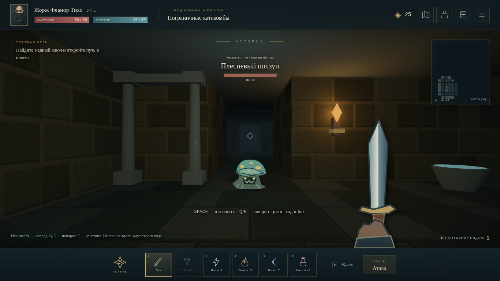

# Runes & Ruins · Руны и руины

[**Play in your browser**](https://pg-runes-and-ruines.register-c02.workers.dev/) · [Source](https://github.com/procrastinate-games/runes-and-ruines) · [Publishing status](https://github.com/procrastinate-games/runes-and-ruines/actions)

An original Russian-language first-person, turn-based dungeon RPG. You are **Жорж Феанор Тихо**, an elven explorer with a rune compass and little patience for ruins that forget their own names. Explore Asterna, restore its seal, and defeat the Nameless Regent.



## Play locally

Node.js 22.12+ (Node 24 recommended) and npm:

```sh
npm install
npm run dev
```

Open the URL printed by Vite (normally http://localhost:5173). No account, server API, external artwork or runtime CDN is required.

```sh
npm test                 # deterministic rules and complete campaign routes
npm run build            # strict TypeScript + production assets in dist/
npm run preview          # serve the production build
npx playwright install chromium
npm run test:browser     # actual desktop/touch browser regressions
```

## Controls

| Action | Keyboard |
| --- | --- |
| Forward / backward | W / S or Up / Down |
| Strafe left / right | A / D |
| Rotate 90° | Q / E |
| Attack | Space or click the dungeon |
| Interact with the object ahead / underfoot | F |
| Wait, restoring focus | R |
| Best owned sword / crossbow | 1 / 2 |
| Spark / Fire Seal / Shockwave | 3 / 4 / 5 |
| Small healing potion | H |
| Inventory / map / journal | Tab / M / J |
| Pause or close a panel | Esc |

Mobile uses landscape orientation, a direction/rotation pad, attack and interaction buttons, three spell slots, and a potion. Portrait shows an explicit rotate-device message. The smallest landscape layout keeps spells available and puts equipment in inventory.

The world moves only after a valid action. Invalid attacks and blocked movement cost nothing. Rotation costs a turn when enemies are alert; equipment selection, maps and menus are free. Haste grants exactly two actions per enemy cycle. Numeric status counters count enemy cycles. Camera animation does not decide the rules.

## Campaign

- Three connected, revisitable authored 17×17 maps: Border Catacombs, Echoing Mines, and the Archive / Seal Chamber.
- Five distinct enemies and a two-phase Regent. Physical armor, elemental weaknesses, ranged tells, cover, pursuit, retreat, burn, stun, knockback and focus weakening.
- Sword, upgraded sword, crossbow, rune focus and optional heavy blade. Three active spells, limited bolts, six consumables, armor, gold, XP and levels 1–4.
- Locked doors, permanent keys, chests, notes, a fog-of-war map, one-use healing springs and three secrets.
- Ordered-rune puzzles and a rotating bridge with a visible clue and shortcut. No consumable critical quest keys.
- Bessa's shop sells consumables and permanent upgrades; an optional note-based negotiation grants a deterministic discount.
- **Антарион Музраэль**, **Хранитель Забытых Истин**, is a friendly library scholar. His optional quest accepts one rune even if found before meeting him, unlocks one secret route, and rewards once. It is not required for the ending.
- Short introductory, NPC and ending dialogue; original Georges portrait, original procedural creature art, stone textures, lighting, spell particles, weapon animation and synthesized WebAudio effects/drone.
- Start, pause/settings/help, journal, map, equipment, defeat/checkpoint retry and one victory screen with statistics.

Independent human testing is still needed to assess the intended 30–60 minute first-play pacing and subjective difficulty. Automated routes use earned resources on normal difficulty, without healing/gear cheats.

## Saves

LocalStorage prefix: `pg:runes-and-ruines:`. Version 1 stores player stats and inventory, facing, persistent enemies in all zones, exploration, keys, opened objects, puzzle progress, flags, purchases, secrets and boss state.

Manual save and milestone checkpoint are separate slots. Checkpoints occur after transitions, important loot, quest milestones and puzzle solutions; defeat never overwrites them. Continue prefers the manual slot; retry loads the checkpoint. Starting a new game warns before replacing the checkpoint. Invalid JSON, unsupported versions and invalid state are rejected safely. Settings have their own key. Browser storage restrictions can disable saving; the UI reports failed manual saves.

## Source layout

```text
src/
  main.ts                # input/action orchestration; inspection hooks
  game/                  # pure deterministic turns, collision, LOS, BFS, combat, AI, quests
    types.ts engine.ts grid.ts rng.ts
  content/               # maps, encounters, items, balance and Russian dialogue
    levels.ts items.ts dialogs.ru.ts russian.ts
  render/                # Three.js view and original Canvas art
    scene.ts art.ts
  ui/                    # HUD, screens, touch controls and original SVG icons
    hud.ts icons.ts
  save/storage.ts        # versioned validation and separate save slots
  audio/effects.ts       # original WebAudio synthesis
  style.css
public/
  game.json cover.webp favicon.svg
  assets/art/portrait_georges.svg
scripts/                 # screenshot inspection and campaign browser replay
  inspect.mjs capture-release.mjs campaign-browser.mjs
tests/                   # deterministic rules, full routes, and Playwright UI regressions
docs/                    # gameplan, story, art brief, architecture and QA record
```

`window.render_game_to_text()` returns a concise state snapshot, and `window.advanceTime(ms)` waits without granting turns. Read-only `window.__GAME__` inspection is available. Mutating `__QA__` helpers exist only in development and are removed from the production bundle.

## Publishing

This project was made from [procrastinate-games/game-template](https://github.com/procrastinate-games/game-template) using its installed [make-game workflow](https://github.com/PlayableIntelligence/game-creator/tree/main/skills/make-game). The organization repository is spelled **runes-and-ruines**; the game title remains Runes & Ruins.

Before a push:

```sh
npm test
npm run build
npx --yes github:procrastinate-games/game-publisher#v1
```

Push `main`. The unchanged `.github/workflows/publish.yml` calls the organization's shared publisher, which installs, tests, builds, smoke-tests, deploys, verifies the live game, and refreshes the portal. The public URL is https://pg-runes-and-ruines.register-c02.workers.dev/ . No per-game Cloudflare tokens or second deployment workflow are needed.

Vite uses `base: './'`. `dist/` is a standalone static build and supports a subpath such as `/runes-and-ruines/` if hosted on GitHub Pages; serve the complete contents of `dist/` at that path. The configured release channel is the organization publisher.

## Art and attribution

See [CREDITS.md](CREDITS.md). All shipped artwork, maps, dialogue and sounds are original. The private reference photograph and historical game screenshots are **not** included in this repository or production assets.

Russian wording was edited after player feedback; the original opening is unchanged. See [the editorial glossary and review scope](docs/russian-editorial.md). Internal IDs and existing saves remain compatible.
